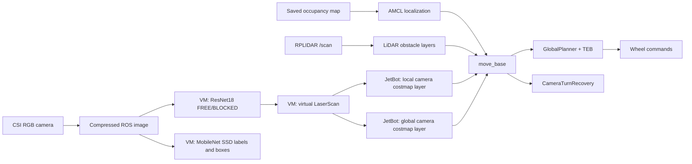
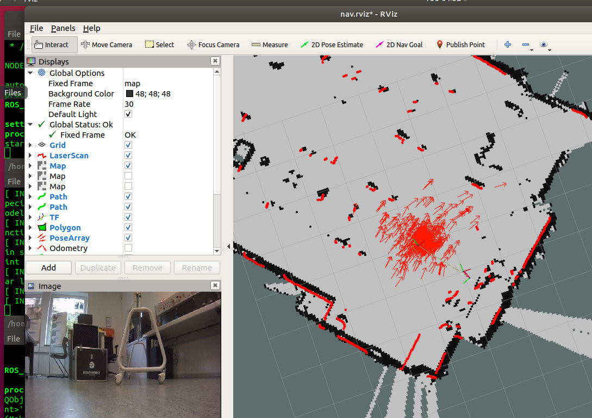
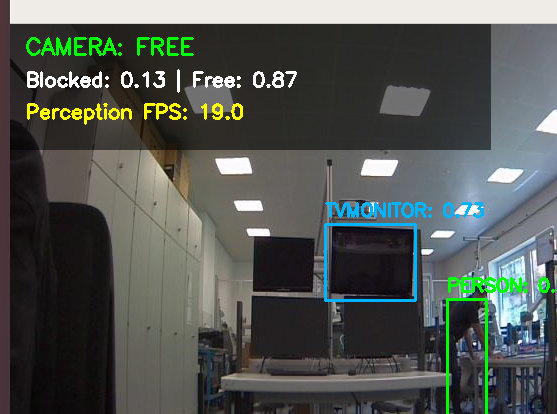
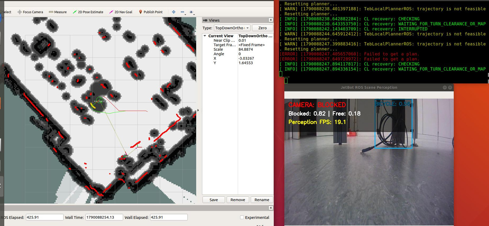
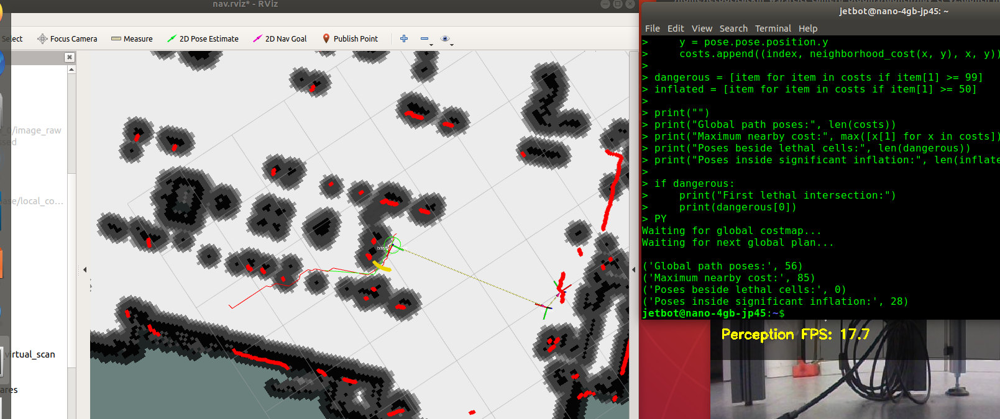

# JetBot Vision-Assisted LiDAR Navigation (CL)

**An experimental ROS 1 navigation extension that incorporates camera-based FREE/BLOCKED decisions into LiDAR-based local and global costmaps.**

**Project author:** Pooya Zare Baravati  
**Platform:** Waveshare JetBot ROS AI Kit / NVIDIA Jetson Nano 4 GB  
**Development:** Robotics & AI Laboratory, Köln, August–September 2026  
**Status:** Experimental baseline; qualitative lab tests, not a validated safety system

**Repository status:** The original source packages `cl_camera_plugins` (JetBot) and `jetbot_mission` (Ubuntu VM) are included, copied from the September 2026 project snapshot. This is a **source archive of an experimental baseline**, not a turnkey installation: the original `jetbot_pro` dependency, customized vendor YAML configuration, map and trained model weights are not included. New deployments have not been validated.

## Overview

Standard LiDAR-based navigation can miss objects that are poorly represented at the 2D laser scanning height. CL investigates whether an RGB camera can provide additional obstacle awareness to an existing ROS navigation stack. A ResNet18 classifier estimates whether the current forward view is **BLOCKED** or **FREE**. A MobileNet SSD detector provides object labels and bounding boxes for visualization. The binary classifier decision, **not** the detector bounding boxes, drives a virtual LaserScan that is fused into temporary ROS navigation costmap layers.

The final experimental configuration uses **custom camera costmap plugins and a clearance-checked recovery behavior**. An earlier velocity-arbitration architecture was explored but is *not* part of the final launch sequence.

## System architecture



The camera is **not** a depth sensor: the 0.40 m virtual obstacle range is a deliberately assumed distance, not a measurement. CL is late fusion at the decision/costmap level, not a jointly trained RGB–LiDAR model.

## Components

| Component | Platform | Role |
|---|---|---|
| ROS 1 Melodic, `jetbot_pro`, `move_base` | JetBot | Robot driver, localization, motion and navigation |
| RPLIDAR + odometry | JetBot | Planar ranging, TF and navigation evidence |
| `cl_camera_plugins` | JetBot | Expiring local/global camera layers; camera-turn recovery |
| `jetbot_mission` | Ubuntu VM | `ros_scene_perception.py`, `camera_virtual_scan.py`, launch files |
| ResNet18 (ONNX opset 9 via OpenCV DNN) | Ubuntu VM | Camera FREE/BLOCKED prediction |
| MobileNet SSD (Caffe via OpenCV DNN) | Ubuntu VM | Object labels and bounding boxes (visual interpretation) |
| RViz | Ubuntu VM | Goal selection, localization and navigation diagnostics |

### Main ROS topics

| Topic | Description |
|---|---|
| `/csi_cam_0/image_raw/compressed` | Compressed CSI camera stream |
| `/camera/blocked` | Binary scene classification state |
| `/camera_virtual_scan` | Synthetic LaserScan derived from camera state |
| `/camera_virtual_scan/state` | Bridge diagnostic state |
| `/scan` | Real LiDAR ranges |
| `/move_base/GlobalPlanner/plan` | Global path |
| `/cmd_vel` | Final robot velocity command |

## Development and outcome

1. **ROS and navigation foundation:** JetBot control, LiDAR, GMapping, saved maps, AMCL, and goal-based navigation were demonstrated.
2. **Camera classification:** ResNet18 was trained on a cleaned 318-image dataset (159 BLOCKED, 159 FREE) and exported to an ONNX opset-9 model for VM inference.
3. **Object detection:** Caffe MobileNet SSD provided scene labels and bounding boxes.
4. **Early CL prototype:** A velocity arbiter could trigger LiDAR-informed turning, but route replanning was unreliable.
5. **Final CL baseline:** The camera provided synthetic scan marks to separate local/global costmap layers; expiring marks, selective FREE clearing, and a clearance-checked camera recovery were tested. The final planner configuration was selected through qualitative trials.

**What worked:** The vision pipeline, temporary camera obstacle integration, and some revised global-route selections were observed in the lab. **What was not established:** A controlled goal-completion rate, collision-free reliability, robust replanning across environments, a final classification confusion matrix, or end-to-end latency statistics.

## Experimental demonstrations

The following screenshots were extracted from the project handover manual and weekly progress reports. They document specific laboratory sessions, **not** controlled success-rate or safety benchmarks.

### 1. LiDAR navigation and localization



*Week 2 report, Figure 5 — AMCL localization on the saved laboratory map with LiDAR observations. This shows the working LiDAR-based navigation foundation, before the CL camera extension.*

### 2. Camera-based scene perception



*Week 4 report — OpenCV DNN scene perception: ResNet18 estimates FREE/BLOCKED (here FREE: 0.87) while Caffe MobileNet SSD labels detected objects. The classifier does not estimate obstacle distance.*

### 3. CL costmap integration and recovery



*JetBot Technical Handover Manual, page 22, Figure 8 (reproduced from Week 5) — development test showing camera-based costmap evidence and a recovery waiting condition. The planner also reported infeasible trajectories. **This is evidence of the mechanism and its limitations, not a successful avoidance trial.***

### 4. Global-path and costmap diagnostics



*Week 5 report, Figure 2 — one sampled path with 56 poses, maximum nearby reported cost 85, zero sampled poses beside lethal cells, and 28 poses in significant inflation. These figures describe one diagnostic snapshot, not overall route quality.*

## Key retained settings

| Setting | Experimental value |
|---|---|
| Global planner | Dijkstra `true`; grid path `false`; quadratic `false` |
| Local planner | TEB |
| Synthetic camera scan | 21 rays, -0.35 to +0.35 rad, 10 Hz |
| Synthetic BLOCKED range | 0.40 m (assumed; *not* measured) |
| Classifier hysteresis | BLOCKED 0.70; FREE 0.40 |
| Global/local camera mark TTL | 15 s / 5 s |
| FREE mark-clearing hold/range | 0.8 s / 0.45 m |
| Global/local inflation radius | 0.35 m / 0.20 m |
| Configured forward/reverse speed limits | 0.30 / 0.15 m/s |
| Camera recovery attempt | Max 10 s; turn 0.60 rad/s |

See [Configuration notes](docs/CONFIGURATION.md) for interpretation and other settings, and [source-review notes](docs/SOURCE_REVIEW.md) for the code actually contained in this repository.

## Run on the existing configured machines

**Requirements:** A functioning JetBot ROS Melodic setup, saved laboratory map and matching map YAML/PGM, the custom source packages and compiled C++ plugin, compatible model files, one reachable ROS master, and valid VM↔JetBot networking. These instructions describe the **original configured installation**, not a clean-slate one-command install.

**Terminal 1 — JetBot**

```bash
source /opt/ros/melodic/setup.bash
source ~/catkin_ws/devel/setup.bash
roslaunch cl_camera_plugins nav_cl_v2.launch \
  map_file:=/home/jetbot/catkin_ws/src/jetbot_pro/maps/week2_lab_map.yaml
```

**Terminal 2 — Ubuntu VM**

```bash
source /opt/ros/melodic/setup.bash
source ~/catkin_ws/devel/setup.bash
export ROS_MASTER_URI=http://nano-4gb-jp45:11311  # adapt to reachable master
roslaunch jetbot_mission camera_navigation_system.launch
```

**Terminal 3 — Ubuntu VM**

```bash
source /opt/ros/melodic/setup.bash
source ~/catkin_ws/devel/setup.bash
export ROS_MASTER_URI=http://nano-4gb-jp45:11311  # adapt to reachable master
roslaunch jetbot_pro view_nav.launch
```

In RViz use the `map` fixed frame; inspect `/camera_virtual_scan` as **LaserScan** and `/move_base/local_costmap/costmap` as **Map**. Estimate the initial pose and check LiDAR-to-map alignment before sending a small supervised goal. The reference notes also mention `jetbot_pro nav_camera_costmap.launch` as an alternative; this repository documents **`cl_camera_plugins nav_cl_v2.launch` as the final baseline**. **Never run both navigation launches together**, and do not run the old camera velocity arbiter with the plugin-based architecture. Do not operate near people or fragile objects without supervision.

For installation prerequisites see [Build and verification](docs/BUILD_AND_VERIFY.md); for verification, cancellation and the operator procedure see [Runbook](docs/RUNBOOK.md).

## Limitations and follow-up study

The FREE/BLOCKED classifier does not estimate obstacle location, distance, shape, or available space. Projecting a binary prediction as a fixed-distance synthetic obstacle can create artificial barriers, especially while the robot turns. False positives and transient camera updates can also affect route selection. The system was resource-constrained; processing rates do not establish image-to-command latency.

A future comparison should use controlled start–goal pairs and compare (1) LiDAR-only, (2) the frozen CL baseline and (3) a spatial-perception alternative such as traversable-area segmentation or calibrated depth. Suggested measures include completion, collisions/interventions, recovery count, path length, time, CPU/GPU load and latency. None of those replacement methods was implemented as part of this CL baseline.

## Repository layout

```text
.
├── README.md
├── docs/
│   ├── ARCHITECTURE.md
│   ├── CONFIGURATION.md
│   ├── DEVELOPMENT_HISTORY.md
│   ├── RESULTS_AND_LIMITATIONS.md
│   ├── RUNBOOK.md
│   └── BEFORE_PUBLISHING.md
├── scripts/
│   └── collect_ros_source.sh
├── jetbot_ws/src/cl_camera_plugins/   # original C++ costmap/recovery source and ROS launch files
└── vm_ws/src/jetbot_mission/           # original Python perception/virtual scan source and ROS launch files
```

**Important:** The two original source packages **are included**. The trained ResNet18 ONNX model, Caffe detector weights, laboratory map, original `jetbot_pro` vendor package and customized vendor configuration are **not included**. The Caffe network description `deploy.prototxt` is present but its provenance/licence still needs review. The original CL report and weekly reports informed this documentation and have **not** been published here; their screenshots may contain people and lab details. Do not publish model weights, maps or images without checking rights and privacy.

## Source and publication notes

- [Build and verification](docs/BUILD_AND_VERIFY.md) explains what is missing for a fresh installation and which checks have/have not been performed.
- [Source review](docs/SOURCE_REVIEW.md) distinguishes the final plugin version from the earlier arbiter and identifies the hard-coded model path.
- [Before publishing](docs/BEFORE_PUBLISHING.md) lists remaining rights, licensing and laboratory-permission checks.
- The original ROS package metadata has been preserved, including its placeholder maintainers. In particular `jetbot_mission/package.xml` says `TODO` for the licence, so **this repository does not yet grant a project-wide open-source licence**. Confirm the appropriate rights and add a top-level `LICENSE` when authorized.

## Attribution

Project developed during an Autonomous Vehicle Engineering traineeship under the supervision of Prof. Frank Joswig (host laboratory) and Prof. Mario Selvaggio (University of Naples Federico II). This repository documents work undertaken by the author, not an official laboratory-supported or safety-certified product.
